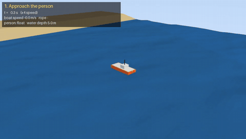

# rescue_sim_ws — MuJoCo 물가 구조 시뮬레이션 (학습용)

TetherRescue 시나리오(바다 · 익수자 · 구조보트)를 **MuJoCo 단독, CPU 기반**으로
최대한 정교하게 만들어 보며 MuJoCo의 한계를 시험한다. ROS2(Jazzy)는 마지막에 연동한다.



▶ 고화질 영상 (2배속, 42초): [docs/rescue_mission_2x.mp4](docs/rescue_mission_2x.mp4)

로봇 보트가 **스스로** 물에 빠진 사람에게 접근 → 로프 연결 → 해안으로 견인 → 얕은 곳에서 로프를 감아 끌어옴
→ 로프를 풀고 비켜 주면 사람이 일어나 모래사장까지 걸어간다. (파도 2종 × 해류 3방향 × 시작 위치 4곳, 8개 조건 모두 성공)

## 단계 로드맵

| 단계 | 내용 | 상태 |
|---|---|---|
| 1. 바다 | 1-1 파도(JONSWAP 합성) · 1-2 수면 시각화(hfield) · 1-3 해저 지형·얕은 물 · 1-4 해류 | ✅ |
| 2. 유체력 | 기둥 부력, 항력(물 입자 속도·해류 기준) — 부가질량 없음 | ✅ 기본 |
| 3. 보트 | 직육면체 선체, 좌우 추진기(차동 추력), 키보드 조종 | ✅ 기본 |
| 4. 익수자 | 구명조끼 입고 누워 뜨는 직육면체(부력 재사용), 발 닿으면 일어서서 걷기(애니메이션) | ✅ 기본 — 패닉 FSM·기도 판정 ⏳ |
| 5. 로프 | spatial tendon 길이 제한(연결·감기·풀기), 탄성 solreflimit, 장력 = 제약력 | ✅ 기본 — 로프 질량·처짐·물 저항 ⏳ |
| 6. 시나리오 | APPROACH → CONNECT → CLEAR → TOW → WINCH → RELEASE → WALK 자율 미션 | ✅ 기본 |
| 7. ROS2 | sim/controller 노드, 토픽, launch | ⏳ |

각 단계는 **구현 → 테스트(test/) → 성능 측정(bench/results/)** 순으로 마무리한다.

## 구조

```
rescue_sim_ws/
├── .venv/                       # Python 3.12 venv (--system-site-packages, ROS2 rclpy 공유용)
├── requirements.txt
├── bench/results/               # 단계별 성능 측정 기록
├── prototype/                   # 초기 프로토타입 (참고용, 사용 안 함)
└── src/rescue_sim/              # ROS2 ament_python 패키지 (colcon 빌드 대상)
    ├── package.xml, setup.py, setup.cfg, resource/
    ├── config/ocean.yaml        # 바다 파라미터 (harbor / rough 프리셋)
    ├── launch/                  # 7단계
    ├── scripts/
    │   ├── view_ocean.py        # 바다만 보기 / 녹화
    │   ├── run_boat.py          # 보트 띄우기: 키보드 조종 / 시나리오 녹화 (MuJoCo 뷰어 창)
    │   ├── run_boat_web.py      # 보트 조종 — 브라우저 뷰어 (WSLg 창이 안 보일 때)
    │   ├── run_rescue_web.py    # 자율 구조 미션 — 브라우저 뷰어
    │   ├── record_rescue.py     # 자율 구조 미션 mp4 녹화
    │   ├── bench_ocean.py       # 바다 성능 측정
    │   └── bench_boat.py        # 보트 성능 측정 (유체력 vs mj_step 시간 분해)
    ├── test/                    # 단계 완료 기준
    └── rescue_sim/
        ├── ocean/               # 1단계 — MuJoCo 비의존 순수 numpy
        │   ├── config.py        #   yaml → dataclass
        │   ├── spectrum.py      #   [1-1] JONSWAP → 성분파
        │   ├── waves.py         #   [1-1,1-3] WaveField.elevation / velocity, 얕은 물 효과
        │   ├── bathymetry.py    #   [1-3] 수심·바닥 높이
        │   └── current.py       #   [1-4] 해류
        ├── hydro/hull.py        # 2단계 — 선체 부력·항력 (MuJoCo 비의존)
        ├── boat/boat.py         # 3단계 — 보트: 유체력·추진기를 MuJoCo 에 연결
        ├── rescue/              # 4~6단계
        │   ├── person.py        #   익수자: 떠 있기(부력) → 일어서기 → 걷기
        │   ├── rope.py          #   로프: tendon 길이 제한으로 연결/감기/해제, 장력
        │   └── mission.py       #   자율 구조 상태 머신 + 조향(PD) + 추진기 비대칭 보정
        ├── sim/                 # MuJoCo 연동
        │   ├── world.py         #   씬 로딩(MjSpec), pre_step 훅, 스텝, 배속 측정
        │   ├── water_surface.py #   [1-2] 파도 → water hfield 갱신
        │   └── web_viewer.py    #   오프스크린 CPU 렌더 → 브라우저 MJPEG 스트리밍
        └── assets/
            ├── ocean_scene.xml  #   수면·해저·조명
            ├── boat_scene.xml   #   ocean_scene include + 보트·추진기·센서
            └── rescue_scene.xml #   boat_scene include + 익수자·로프
```

설계 원칙: `ocean/`은 MuJoCo를 모른다 → 단위 테스트가 쉽고, 부력·시각화·ROS 노드가 같은 인터페이스를 공유.

## 처음 설치 (다른 PC)

Ubuntu 24.04 (WSL2 포함) 기준, GPU 없어도 됨 (CPU 렌더링).

```bash
sudo apt install python3.12-venv libegl1 libgl1-mesa-dri   # 가상환경 + 화면 없는 CPU 렌더링(EGL)
git clone https://github.com/ODK2/TetherRescue-test.git rescue_sim_ws
cd rescue_sim_ws
python3 -m venv --system-site-packages .venv               # system-site: 나중에 ROS2 rclpy 공유용
source .venv/bin/activate
pip install -r requirements.txt
pip install -e src/rescue_sim
pytest -q src/rescue_sim/test                              # 35 passed 면 준비 완료 (~1분 20초)
```

`sudo` 를 못 쓰는 PC 에서 `python3 -m venv` 가 *ensurepip is not available* 로 실패하면:

```bash
python3 -m venv --without-pip --system-site-packages .venv
curl -sS https://bootstrap.pypa.io/get-pip.py | .venv/bin/python
```

## 실행

```bash
cd ~/study/rescue_sim_ws
source .venv/bin/activate

pytest -q src/rescue_sim/test
python src/rescue_sim/scripts/run_boat.py                   # 보트 조종 (↑↓ 추력, ←→ 조향, Home 정지)
python src/rescue_sim/scripts/run_boat.py --preset rough --current 0.3 0
MUJOCO_GL=egl python src/rescue_sim/scripts/run_boat.py --video boat.mp4
python src/rescue_sim/scripts/view_ocean.py                 # 바다만
python src/rescue_sim/scripts/bench_boat.py
```

### 브라우저 뷰어 (WSL 에서 MuJoCo 창이 안 보일 때, CPU 렌더링)

Ubuntu 안에서 화면 없이(EGL + llvmpipe) 그려서 `localhost` 로 스트리밍한다. WSL2 는 localhost 를 Windows 와 공유하므로
**Windows 브라우저에서 `http://localhost:8000`** 을 열면 된다.

```bash
python src/rescue_sim/scripts/run_rescue_web.py               # 자율 구조 미션 (R: 다시 시작, C: 카메라 전환)
python src/rescue_sim/scripts/run_rescue_web.py --preset rough --current 0.0 0.3 --person 25 -6
python src/rescue_sim/scripts/run_boat_web.py                 # 보트 직접 조종 (↑↓←→, Home 정지)
python src/rescue_sim/scripts/record_rescue.py rescue.mp4     # 미션 녹화 (기본 2배속)
```

Windows 쪽 Python 으로 MuJoCo 뷰어 창을 띄우려면 `run_boat_windows.bat` (최초 설정은 파일 안 주석 참고).

## 확인된 한계 (MuJoCo + Python 구성)

| 항목 | 측정 / 내용 | 영향 · 대응 |
|---|---|---|
| **Python 유체력이 병목** | 1스텝: mj_step 11 µs vs 유체력 175 µs → 보트 1척 약 10배속 (`bench/results/2-3.txt`) | 물체가 늘면 선형으로 느려짐. 익수자 추가 시 ~5배속 예상. 필요하면 유체력을 2스텝마다 계산하거나 C 플러그인/numba |
| numpy 호출 횟수 | 점 개수보다 호출 횟수가 비용을 좌우 | 수면 높이 질의를 한 번에 모아서 호출 (6.3 → 11.9배속) |
| WSL 소프트웨어 렌더링 | llvmpipe 가 CPU 전 코어 사용 → numpy 멀티스레드와 경합 15배 느려짐 | `OPENBLAS_NUM_THREADS=1` (모든 스크립트·테스트) |
| 수면 hfield | 128² 갱신 0.12 ms(사전계산). 512² 는 3.5 ms → 11배속 | 128 유지. 시각 전용(contype=0) |
| 해저 hfield 충돌 | 컴파일 때 충돌 경계 계산 → 높이 범위는 컴파일 전(MjSpec) 확정 필요. userdata 는 컴파일 때 0~1 로 재정규화됨 | 범위는 MjSpec, 데이터는 컴파일 후 직접 기록 |
| 바닥에 닿은 물체 | 보트가 해저에 얹히면 mj_step 11 → 40 µs (hfield 접촉 계산) | 해안 접근 시나리오에서 배속 하락 감안 |
| 부가질량 없음 | 출렁임 주기가 실제보다 짧음 (보트 위아래 고유주기 ≈ 0.65 s) | 4단계 전 필요하면 추가 |
| 선체 = 직육면체 | 부력 기둥 6×3, 작은 기울기 가정 | 조종성은 계수로 맞춤(직진 2.6 m/s, 선회 ~30°/s) |
| 1스텝 지연 | pre_step 은 직전 스텝의 위치로 힘 계산 (2 ms 지연) | 현재 무시 가능 |
| **로프 = 거리 제한** | tendon 은 두 점 직선 거리만 봄. 질량·처짐·물 저항·부력 없음 (화면의 처짐은 그림만) | 장력 값은 근사치. 정밀하게는 짧은 막대 사슬 등 필요 |
| 로프 강성 | 기본 solreflimit(0.02)은 강철봉처럼 즉시 정지 → 팽팽해질 때 충격 4.8 kN | 0.2 → ~470 N, 8 m 에 ~17 cm(2%) 늘어남. 재질 값이 아니라 튜닝 값 |
| 추진기 비대칭 | 후진 150 N vs 전진 300 N → 제자리 회전 시 앞으로 150 N 남아 모래톱 좌초 | `mission.balance_thrust` 로 합력 보정 |
| 익수자 자세 안정 | 폭 방향 부력 기둥 2개·높은 무게중심이면 5초 만에 엎어짐. 로프 고리 높이 0.12 m → 옆으로 당길 때 63° 굴러감 | 기둥 4개·무게중심 낮춤(구명조끼 흉내), 고리 0.04 m → 최대 32° |
| 걷기 = 애니메이션 | 일어서기·걷기는 qpos 직접 지정(kinematic) + geom 위치로 팔다리 흔들기. 파도·물 저항 무시 | 물리 기반 보행은 관절 모터 + 제어(RL) 필요 |
| 실행 중 모델 고정 | 컴파일 후 body 추가·삭제 불가 | 로프는 미리 만들어 숨겨 두고 tendon_range/rgba 로 켜고 끔. 재시작은 전체 재컴파일 |
| CPU 렌더링 | 960×540 그리기 + 수면 업로드 ~50 ms/장 (그림자 끄면 ~40% 절약) | 브라우저 뷰어는 물리를 벽시계에 맞추고 화면은 ~14 fps |
| 가정 | 익수자 위치를 오차 없이 앎, 로프는 거리 조건만 맞으면 즉시 연결, 바다 영역 50 m × 50 m | 다음 단계 후보 |


### ROS2 (7단계에서 필요)
Ubuntu 24.04 → ROS2 **Jazzy** (`sudo apt install ros-jazzy-ros-base python3-colcon-common-extensions`).
venv는 `--system-site-packages`로 만들어 두었으므로 `source /opt/ros/jazzy/setup.bash` 후 rclpy를 그대로 쓸 수 있다.
